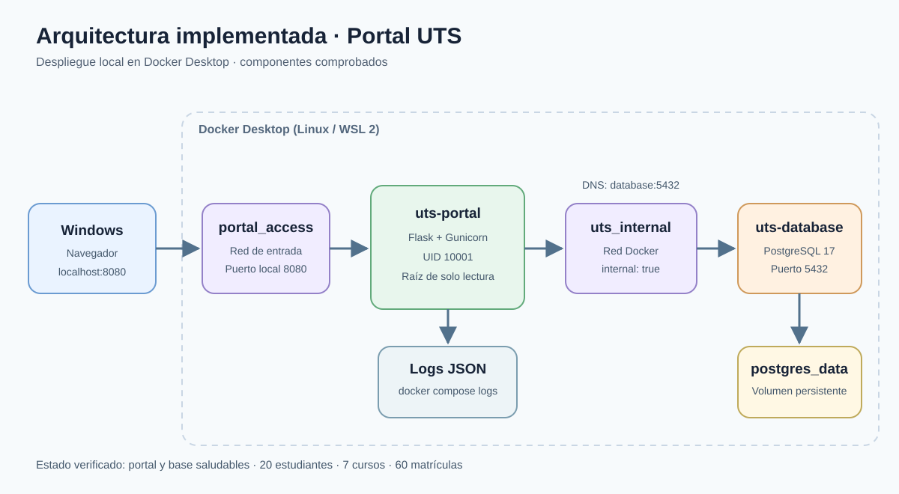

# Arquitectura implementada y verificada

**Estado:** portal y base saludables; consultas de 20 estudiantes, 7 cursos y 60 matrículas validadas. Wazuh y Falco aún no forman parte de esta arquitectura. El dashboard y las alertas de seguridad se incorporarán solo después de instalarlos y verificarlos.
