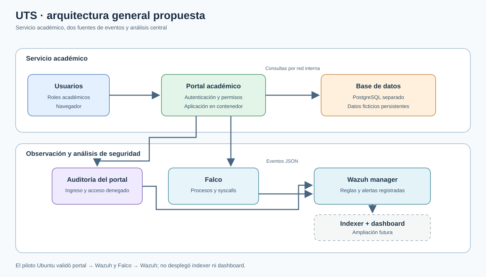
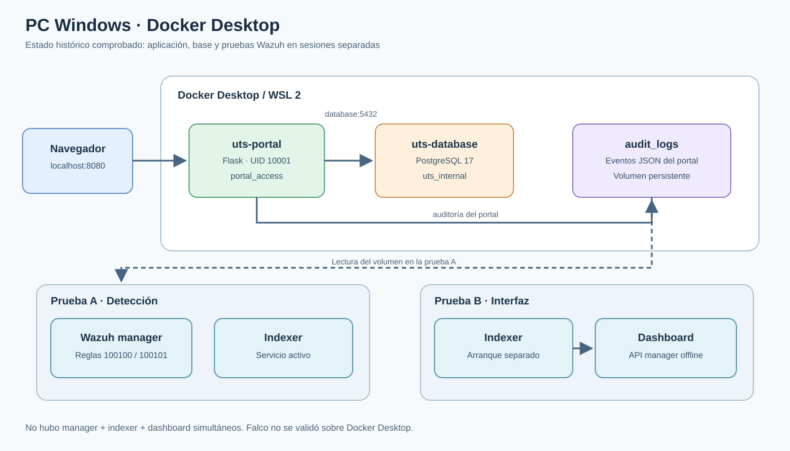
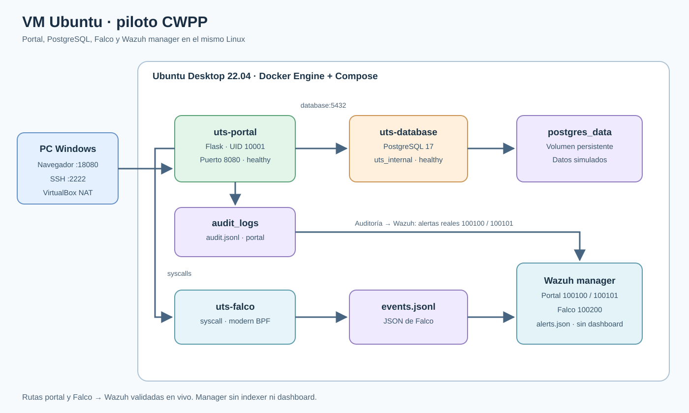

# Arquitectura del piloto CWPP

La propuesta general muestra el servicio académico y sus dos fuentes de eventos. Los dos despliegues corresponden al mismo equipo físico: Windows conserva las pruebas iniciales y la VM Ubuntu es el piloto integrado actual. No se atribuye a Falco cobertura sobre los contenedores de Docker Desktop.

## Propuesta general

[Abrir PNG para el informe](evidencias/arquitectura-general.png). La visualización con indexer y dashboard está marcada como ampliación futura; Ubuntu solo ejecuta el manager.

## 1. PC Windows · Docker Desktop

[Abrir PNG para el informe](evidencias/arquitectura-windows.png).

El navegador entra por `localhost:8080` al portal Flask/Gunicorn. El portal consulta PostgreSQL por `uts_internal` y escribe auditoría JSON en `audit_logs`. Wazuh 4.14.9 se probó en dos sesiones separadas por el límite de memoria: **manager + indexer** registraron alertas reales `100100` y `100101`; después, **indexer + dashboard** permitieron ingresar a la interfaz con la API del manager desconectada. No se comprobó el stack completo simultáneo ni Falco sobre Docker Desktop. Ver [fase D](fase-d-wazuh.md).

## 2. VM Ubuntu · Docker Engine

[Abrir PNG para el informe](evidencias/arquitectura-ubuntu.png).

VirtualBox usa NAT: Windows accede al portal por `localhost:18080` y a SSH por `localhost:2222`. Dentro de Ubuntu, `uts-portal` y `uts-database` están saludables. PostgreSQL usa el volumen `postgres_data`; el portal escribe auditoría en `audit_logs`. Falco 0.45.0 observa las llamadas al sistema del portal mediante modern BPF y escribe eventos JSON. Wazuh manager 4.14.9 lee esos eventos y registró una alerta real `100200` en `alerts.json`. Las [capturas 24–27](capturas-evidencia.md) y la [fase H](fase-h-preparacion-wazuh-falco.md) documentan la prueba.

La ruta `audit_logs → Wazuh` también se validó en Ubuntu: una nueva prueba de roles produjo las alertas reales `100100` (`login_failed`) y `100101` (`access_denied`) a las **01:39:43 UTC del 22 de octubre de 2026**. Las reglas `100102` y `100103` están instaladas, pero solo se probaron con eventos sintéticos en Windows. La [fase I](fase-i-auditoria-wazuh-ubuntu.md) documenta el procedimiento y la evidencia. La VM no ejecuta indexer ni dashboard.

## Límites de la representación

Los diagramas indican componentes y flujos comprobados o expresamente marcados como pendientes. El piloto usa datos y cuentas ficticias. El acceso HTTP y el reenvío NAT son locales; para publicar el servicio fuera del equipo se necesitarían HTTPS y controles de acceso adicionales. El manager, Falco, portal y base comparten recursos de una VM de laboratorio, por lo que esta topología no implica alta disponibilidad.
