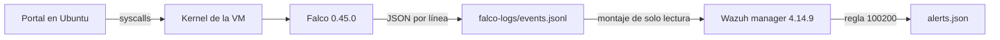

# Fase H: integración Falco → Wazuh manager en Ubuntu

Estado: **integración en vivo validada** en la VM Ubuntu con Wazuh manager 4.14.9. El dashboard y el indexer no forman parte de esta prueba.

## Punto de partida

En la VM Ubuntu, `df -h` mostró 14 GB disponibles de un disco de 29 GB y `free -h` mostró aproximadamente 2,4 GiB de memoria disponible. Estas cifras no alcanzan el mínimo del despliegue Docker oficial completo de Wazuh, que incluye manager, indexer y dashboard. Se preparó una prueba limitada al **manager**, con un techo de memoria de 1,5 GiB y sin puertos publicados. El dashboard no forma parte de esta prueba.

Falco 0.45.0 escribe alertas JSON de una línea en `falco-logs/events.jsonl`. La ejecución controlada `echo prueba-falco-json` produjo una alerta real a las **01:01:40 UTC del 22 de octubre de 2026**, regla `Terminal shell in container`, prioridad `Notice`, contenedor `uts-portal`. `scripts/verificar_falco_json.py` pudo leerla y el portal respondió `status: ok`, `database: connected`. Esto validó el origen de los eventos antes de iniciar Wazuh.

## Ruta de integración verificada

Los archivos `deploy/ubuntu/wazuh-manager.compose.yaml`, `wazuh-manager.conf` y `wazuh-falco-rules.xml` implementan esa ruta. La imagen derivada elimina solo el servicio Filebeat, que enviaría datos a un indexer ausente. El manager conserva el análisis local y la escritura de `alerts.json` en un volumen. El archivo Falco se monta en modo de solo lectura, con permisos de grupo restringidos. `wazuh-remoted` necesita un bloque `<remote>` aunque no se publiquen sus puertos; se añadió después de detectar el error de arranque en la primera prueba.

## Resultados del 22 de octubre de 2026 (UTC)

1. `wazuh-analysisd`, `wazuh-logcollector`, `wazuh-remoted`, `wazuh-db` y `wazuh-apid` quedaron activos. Portal y PostgreSQL continuaron saludables, y Falco permaneció activo.
2. `wazuh-logtest` reprodujo un evento Falco previo. En la fase 3 coincidió la regla **100200**, nivel **8**. Esa reproducción comprobó la regla, no la ingesta en vivo.
3. Una nueva shell controlada en `uts-portal` produjo el marcador `prueba-falco-wazuh`. `scripts/verificar_wazuh_falco.py` encontró en `/var/ossec/logs/alerts/alerts.json` una alerta real **100200**, nivel **8**, con ese marcador y hora Wazuh **01:17:48.556 UTC**. El portal respondió después `{"database":"connected","status":"ok"}`.
4. En una muestra tomada tras arrancar Wazuh, el manager consumía **114,5 MiB** de su límite de **1,5 GiB**; Ubuntu tenía **2,2 GiB** de memoria disponible y **9,2 GB** libres en `/`. Son valores puntuales, no promedios ni una garantía de funcionamiento sostenido.

La evidencia textual depurada está en [wazuh-falco-ubuntu-verificacion.json](evidencias/wazuh-falco-ubuntu-verificacion.json).

## Evidencia a capturar

1. `24-falco-json-local.png`: salida de `sudo python3 scripts/verificar_falco_json.py` con hora, regla, prioridad, contenedor y ruta del archivo JSON.
2. `25-wazuh-manager-ubuntu.png`: manager, Falco, portal y base en `docker compose ps -a`, más consumo puntual. Solo después de arrancar Wazuh.
3. `26-wazuh-logtest-falco.png`: fase de regla `100200` en `wazuh-logtest`, rotulada como reproducción.
4. `27-wazuh-alerta-falco-real.png`: regla `100200` y marcador `prueba-falco-wazuh` leídos de `alerts.json` tras un evento nuevo. Esta es la evidencia de integración en vivo.

Las capturas se guardan localmente en `docs/evidencias/capturas/` y no se publican en Git. No capturar `.env`, contraseñas ni el log completo de Falco; puede contener comandos y rutas sensibles.

## Fuentes

- [Falco: salida JSON y archivo](https://falco.org/docs/concepts/outputs/channels/).
- [Wazuh: recolección de archivos JSON](https://documentation.wazuh.com/current/user-manual/reference/ossec-conf/localfile.html).
- [Wazuh: análisis y archivo de alertas](https://documentation.wazuh.com/current/user-manual/capabilities/log-data-collection/how-it-works.html).
- [Wazuh: requisitos del despliegue Docker completo](https://documentation.wazuh.com/current/deployment-options/docker/wazuh-container.html).
