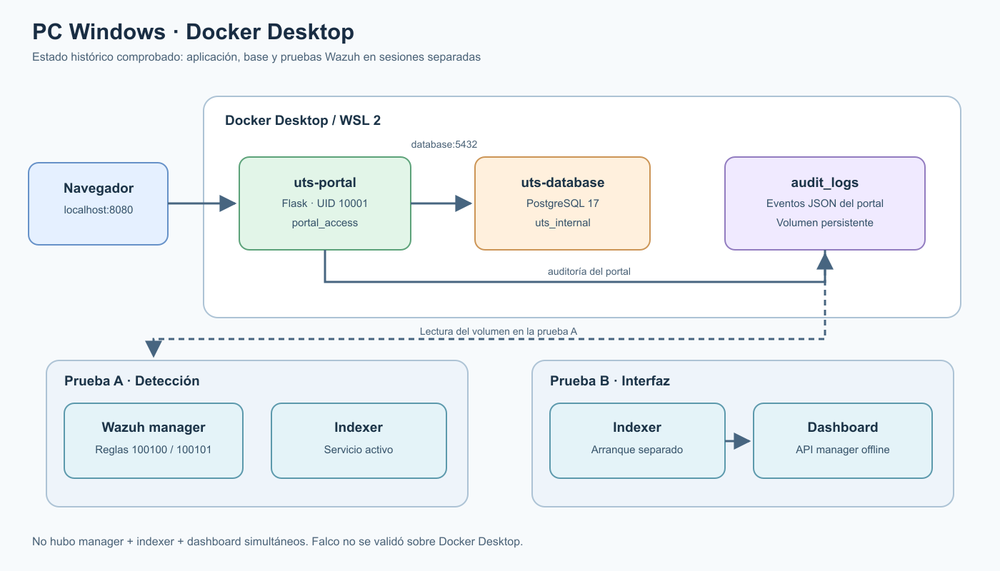
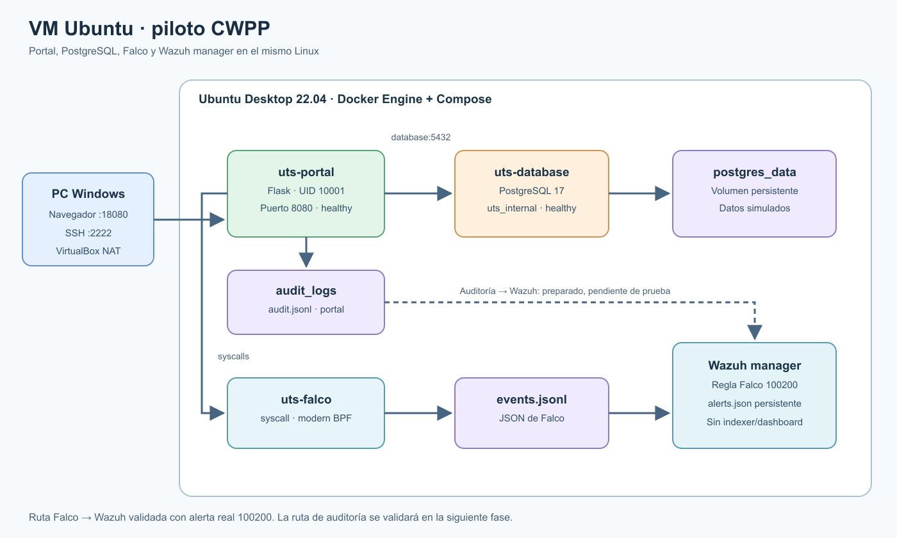

# Implementación y validación del piloto CWPP de la Universidad Tecnológica del Sur

**Aporte técnico del integrante 2 para el informe grupal de Examen Parcial — Cloud Computing**

**Caso:** Universidad Tecnológica del Sur (UTS), institución ficticia.

**Corte de evidencia:** 22 de octubre de 2026, hora UTC.

**Estado:** piloto local verificado; no despliegue productivo.

> **Nota de integración para el integrante 4.** Este texto continúa la estructura de `Examen Parcial.pdf`: caso de estudio → marco teórico → análisis de amenazas → requisitos funcionales y no funcionales. Insértalo después de los criterios de verificación de RF/RNF como sección de **arquitectura, implementación y evaluación**. El caso institucional, matriz de riesgos y justificación teórica originales no se reemplazan. En el informe final unifica portada, numeración, citas y referencias del grupo; conserva los límites técnicos y pies de figura de este aporte.

## 5. Arquitectura del piloto

### 5.1. Correspondencia con el caso de estudio

El caso de estudio considera un servidor Linux, una aplicación académica en un contenedor y una base de datos en otro. El piloto implementa ese recorrido con una VM Ubuntu en VirtualBox, un portal Flask/Gunicorn y PostgreSQL 17. Añade dos fuentes de seguridad: auditoría JSON del portal y detección de actividad de procesos con Falco. Wazuh manager procesa ambas fuentes y registra alertas en `alerts.json`.

Se utilizaron cuentas y registros ficticios: 20 estudiantes, 7 cursos y 60 matrículas. Los perfiles estudiante, docente y administrador tienen vistas diferenciadas. El estudiante solo consulta sus matrículas; docente y administrador pueden consultar el directorio completo de estudiantes. El navegador de Windows entra a la VM mediante un reenvío NAT local al puerto 18080. La VM no publica Wazuh hacia el anfitrión.

**Figura 1.** PC Windows: portal y base en Docker Desktop. Las sesiones de Wazuh manager/indexer y de indexer/dashboard fueron separadas; en la segunda, la API del manager figuró desconectada. Esta figura documenta la evolución, no una topología simultánea completa.

**Figura 2.** VM Ubuntu: portal y PostgreSQL; Falco observa actividad del runtime del mismo kernel; Wazuh manager lee eventos Falco y auditoría del portal. Las tres alertas 100100, 100101 y 100200 fueron observadas en esta VM. No hay indexer ni dashboard.

### 5.2. Componentes y flujos

| Componente | Función | Implementación comprobada |
| --- | --- | --- |
| Portal | Autenticación, autorización y consultas académicas | Flask/Gunicorn, contenedor `uts-portal`, puerto 8080 de la VM |
| Base | Persistencia de datos ficticios | PostgreSQL 17, `uts-database`, volumen `postgres_data` y red interna |
| Auditoría | Registro de eventos de aplicación | JSON en volumen `audit_logs`, montado de solo lectura por el manager |
| Falco | Detección de shell en el contenedor | Falco 0.45.0, modern BPF, JSON local en `falco-logs/events.jsonl` |
| Wazuh manager | Decodificación y reglas | Wazuh 4.14.9; reglas locales 100100/100101/100200; `alerts.json` persistente |

El portal consulta la base por una red Docker interna. La base no publica el puerto 5432. El portal corre con UID 10001, sistema de archivos raíz de solo lectura, capacidades eliminadas, `no-new-privileges` y límites de memoria y procesos. El sensor Falco necesita permisos elevados para observar el kernel; estos controles del portal no se le atribuyen. Wazuh manager lee los dos orígenes de eventos sin escribir en sus archivos fuente. Los datos y alertas conservan volúmenes separados.

## 6. Implementación reproducible

El repositorio versiona `ubuntu.compose.yaml` en la raíz para clonar y ejecutar, además de `deploy/ubuntu/compose.yaml`, `falco.compose.yaml`, `wazuh-manager.compose.yaml`, reglas XML, configuración de Wazuh, código del portal, esquema SQL y scripts de prueba. El portal se construye ahora desde `app/backend` y se etiqueta `uts-cwpp-portal:local`, para que otro integrante pueda reproducir el mismo front desde el commit utilizado. Las credenciales se generan localmente con `scripts/preparar_ubuntu.py` y permanecen fuera de Git. [La guía de reproducción](guia-reproduccion.md) incluye instalación, arranque, permisos de los volúmenes, pruebas y parada sin borrar datos.

El ZIP de Ubuntu se genera mediante una lista blanca con `python scripts/paquetizar_ubuntu.py`. Incluye la fuente del portal y los archivos de despliegue, pero no `.env`, contraseñas, capturas originales, certificados ni logs completos. También se puede trabajar directamente con el clon Git. La versión exacta se registra con `git log -1 --oneline` antes de tomar evidencia.

## 7. Verificación frente a amenazas y requisitos

### 7.1. Resultados observados

La prueba funcional comprobó ingreso y salida de los tres roles, 20 estudiantes, 7 cursos y 60 matrículas, además de una respuesta HTTP 403 para una vista no permitida al estudiante. El análisis de la imagen con Docker Scout reportó un hallazgo alto de zlib; ese resultado identifica una vulnerabilidad conocida, pero no demuestra explotación ni remediación.

Falco detectó una shell controlada dentro de `uts-portal`. Después de convertir su salida a JSON, Wazuh manager procesó un **evento nuevo** y registró la regla 100200, nivel 8, a las 01:17:48.556 UTC del 22 de octubre de 2026. La reproducción separada con `wazuh-logtest` confirmó la coincidencia de la regla, pero la evidencia de recepción en vivo es la búsqueda de ese evento en `alerts.json`.

El mismo manager leyó después el volumen de auditoría del portal. Una prueba nueva de roles produjo `login_failed` con regla 100100, nivel 7, y `access_denied` con regla 100101, nivel 6, a las 01:39:43 UTC. Tras esas pruebas, `/health` devolvió `{"database":"connected","status":"ok"}`. La ruta de auditoría describe acciones registradas por la **aplicación**; no es auditoría directa del motor PostgreSQL.

En otra sesión de Windows, una caída controlada de PostgreSQL dio HTTP 503 durante la interrupción y HTTP 200 tras la recuperación, con eventos `service_unavailable` y `database_query_failed` en el log del portal. Las reglas Wazuh 100102/100103 se probaron con eventos **sintéticos**; no hay evidencia de una alerta en vivo de disponibilidad en Ubuntu.

### 7.2. Matriz de requisitos del examen

| Requisito | Estado del piloto | Evidencia y límite |
| --- | --- | --- |
| RF-01 Acceso no autorizado | Verificado | HTTP 403, auditoría y alerta real Wazuh 100100/100101 en Ubuntu. |
| RF-02 Vulnerabilidades | Verificado como identificación | Scout reportó zlib alto en la imagen anterior; corrección no demostrada. |
| RF-03 Configuraciones inseguras | Parcial | Se documentó endurecimiento efectivo del portal; no se ejecutó una prueba específica con configuración insegura preparada. |
| RF-04 Procesos sospechosos | Verificado | Falco detectó shell en `uts-portal`; Wazuh generó alerta real 100200. |
| RF-05 Acceso a base | Parcial | El portal registró consultas `data_access`; no hay auditoría interna de PostgreSQL. |
| RF-06 Interrupciones | Verificado en portal | Caída y recuperación controladas en Windows con HTTP 503/200 y auditoría; no alerta Wazuh real de 100102/100103 en Ubuntu. |
| RNF-01 Disponibilidad | Verificación acotada | Portal/base healthy y `/health` ok tras pruebas; sin ensayo de carga o continuidad prolongada. |
| RNF-02 Linux y Docker | Verificado | Los cuatro contenedores ejecutaron juntos en Ubuntu VirtualBox. |
| RNF-03 Administración | Documentado | Compose, scripts y guía de reproducción; falta medir esfuerzo operativo sostenido. |
| RNF-04 Integridad de registros | Parcial | Volúmenes y permisos de lectura restringida; sin prueba formal de inmutabilidad o retención. |
| RNF-05 Recursos | Medido puntualmente | `docker stats`, `free -h` y `df -h`; no se midió promedio bajo carga ni comparación sostenida. |
| RNF-06 Ampliación | Diseñado | [VMs, Kubernetes y serverless](extensiones-arquitectura.md) descritos; no desplegados. |

## 8. Evidencia visual y lectura correcta

Las figuras de arquitectura versionadas se pueden insertar directamente. Las capturas originales están en `docs/evidencias/capturas/` solo en el equipo del proyecto. Para el informe se recomiendan: 16 para portal/base y prueba de roles; 18 y 20 para sensor y detección Falco; 27 para la alerta real Falco → Wazuh; 28 para alertas reales del portal → Wazuh; 29 para el estado de cuatro contenedores y recursos. La captura 26 corresponde solo a `wazuh-logtest` y la 15 muestra dashboard con API offline. [La guía de análisis](guia-analisis-evidencias.md) contiene pie de figura sugerido, clasificación y límites de las 29 posiciones.

Los resultados depurados y versionados se encuentran en [wazuh-falco-ubuntu-verificacion.json](evidencias/wazuh-falco-ubuntu-verificacion.json), [wazuh-portal-ubuntu-verificacion.json](evidencias/wazuh-portal-ubuntu-verificacion.json), [disponibilidad-postgresql.json](evidencias/disponibilidad-postgresql.json) y [metricas-base.json](evidencias/metricas-base.json). Los valores de recursos son muestras puntuales. En la última muestra Ubuntu tenía cuatro contenedores activos, 2,4 GiB de memoria disponible y 9,0 GB libres en disco; Wazuh manager usaba 404,8 MiB. Estas cifras no prueban estabilidad prolongada.

## 9. Límites, pendientes y entrega al integrante 4

El alcance verificado es una VM de laboratorio. Wazuh Ubuntu funciona solo como manager; no incluye indexer ni dashboard. Falco observa el kernel de Ubuntu, no los contenedores de Docker Desktop de Windows. La imagen anterior del portal mantiene el hallazgo de Scout hasta que un nuevo escaneo de la imagen reconstruida demuestre lo contrario. El archivo JSON de Falco requiere vigilancia de tamaño y política de retención. La red y las credenciales de demostración no son una configuración de producción.

Al integrar este aporte, el integrante 4 debe: (1) conservar la secuencia y la terminología del examen; (2) insertar las figuras 1 y 2 con los pies anteriores; (3) enlazar la matriz RF/RNF a la matriz de riesgos R01–R06; (4) escoger capturas según la guía y trasladarlas por separado; (5) mantener explícitos los estados “verificado”, “parcial” y “diseñado”; (6) unificar la bibliografía y paginación del informe del grupo. La guía de reproducción permite repetir las pruebas sobre otro clon sin distribuir secretos.

## Referencias internas del aporte

- `Examen Parcial.pdf`, documento de caso y requisitos proporcionado para el proyecto; estructura y RF/RNF tomados como referencia.
- [Arquitectura y diferencias entre entornos](arquitectura-actual.md).
- [Fases F a I](fase-f-falco-ubuntu.md) y [entrega técnica resumida](entrega-integrante-2.md).
- [Guía de reproducción](guia-reproduccion.md) y [guía de análisis de imágenes](guia-analisis-evidencias.md).
