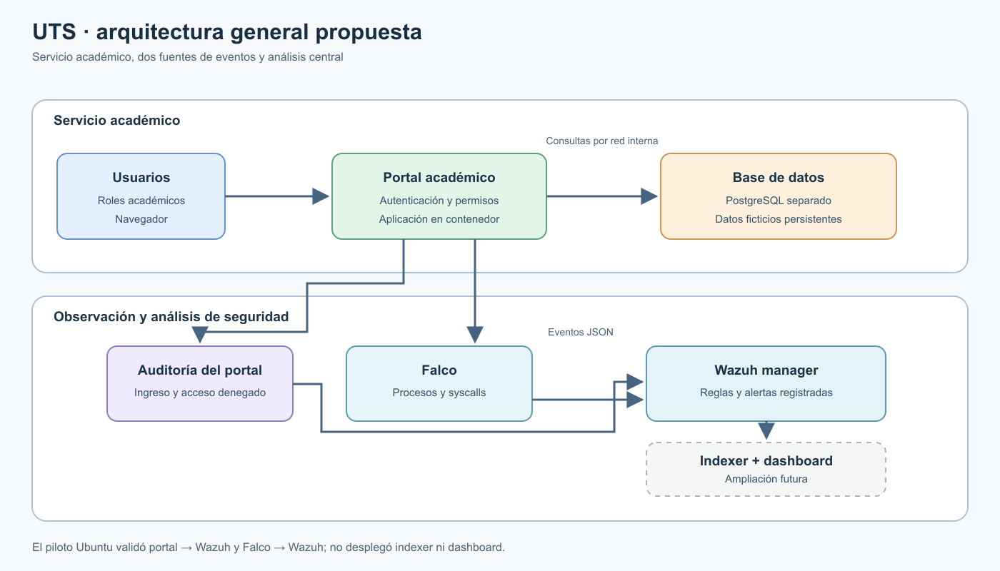

# Avance del prototipo CWPP para la Universidad Tecnológica del Sur

**Aporte del integrante 2 · Examen Parcial de Cloud Computing**

**Caso:** Universidad Tecnológica del Sur (UTS), institución ficticia.

**Corte de evidencia:** 22 de octubre de 2026, hora UTC.
**Estado:** prototipo local validado en laboratorio.

## 1. Alcance del prototipo

El prototipo representa el servicio académico de la UTS con un portal web y PostgreSQL en contenedores. El entorno integrado funciona en una VM Ubuntu de VirtualBox. Utiliza datos ficticios de 20 estudiantes, 7 cursos y 60 matrículas, y tres perfiles: estudiante, docente y administrador. El estudiante consulta sus matrículas; docente y administrador acceden al directorio permitido.

El alcance de protección incluye control de acceso, auditoría JSON del portal, detección de procesos con Falco y análisis de eventos con Wazuh manager. Se validaron dos flujos de alertas reales en Ubuntu: Falco → Wazuh y portal → Wazuh. Windows accede al portal de la VM por un reenvío NAT local. El rediseño visual del portal se probó por separado en Windows; la VM de las evidencias conserva la interfaz anterior.

Ubuntu contiene Wazuh manager sin indexer ni dashboard. Las pruebas históricas de Docker Desktop en Windows corresponden a otro entorno. Los resultados describen un laboratorio y no establecen rendimiento o disponibilidad de producción.

## 2. Cómo la arquitectura y la propuesta solucionan el problema de la UTS

El caso de la UTS concentra información académica en una aplicación y una base contenedorizadas. El acceso indebido, la ejecución inesperada dentro del contenedor y la interrupción de la base afectan la confidencialidad y continuidad. La propuesta aplica permisos por rol y registra acciones en el portal; Falco observa procesos del kernel Ubuntu; Wazuh manager analiza los dos orígenes y conserva alertas con reglas identificables.

PostgreSQL queda en una red Docker interna y no publica su puerto al anfitrión. Los volúmenes separan datos académicos y registros de seguridad. Wazuh monta los registros fuente para lectura. El portal reduce privilegios y escritura en su contenedor. Las pruebas de acceso denegado, shell detectada y salud del servicio muestran controles operativos durante los escenarios ensayados.

## 3. Arquitectura propuesta

### 3.1. Arquitectura general



**Figura 1.** El usuario accede al portal; este consulta PostgreSQL y emite auditoría. Falco observa ejecución de procesos. Wazuh recibe registros del portal y de Falco, aplica reglas y guarda alertas. Indexer y dashboard se representan como ampliación futura.

La arquitectura separa el servicio académico del plano de observación. El primero atiende consultas y conserva datos ficticios; el segundo recibe eventos estructurados y documenta detecciones. Así se distingue un evento registrado por la aplicación de uno detectado por el sensor del runtime.

### 3.2. Arquitectura implementada en Ubuntu


**Figura 2.** En la misma VM funcionan `uts-portal`, `uts-database`, `uts-falco` y `uts-wazuh-manager`. Falco observa el kernel de Ubuntu; Wazuh lee su JSON y la auditoría del portal. Las alertas 100100, 100101 y 100200 quedaron en `alerts.json`.

El navegador de Windows alcanza el portal mediante NAT local al puerto 18080. PostgreSQL permanece en la red interna. La topología Windows de pruebas previas no se suma a esta figura como un despliegue simultáneo.

## 4. Elementos y su uso

| Elemento | Uso | Evidencia |
| --- | --- | --- |
| Portal Flask/Gunicorn | Autenticación, permisos, consultas y auditoría. | Tres roles, HTTP 403 y `/health` con `status: ok`. |
| PostgreSQL 17 | Datos académicos ficticios persistentes. | Contenedor saludable y 20 estudiantes, 7 cursos, 60 matrículas. |
| Docker Compose | Redes, volúmenes, límites y arranque reproducible. | Cuatro servicios ejecutados en Ubuntu. |
| Falco 0.45.0 | Detección de procesos con modern BPF y salida JSON. | Shell controlada atribuida a `uts-portal`. |
| Wazuh manager 4.14.9 | Decodificación, reglas y alertas. | Reglas reales 100100, 100101 y 100200. |
| Docker Scout | Examen de paquetes de una imagen. | Hallazgo alto de zlib en la imagen examinada. |
| Guías y scripts | Preparación y repetición de pruebas. | Verificadores y guía de reproducción versionados. |

El portal usa UID 10001, raíz de solo lectura, capacidades eliminadas, `no-new-privileges` y límite de 256 MiB. Falco requiere permisos elevados para observar el kernel; las restricciones del portal no se atribuyen al sensor. Las credenciales y los registros completos permanecen fuera de Git.

## 5. Relación con requisitos

| Requisito del examen | Estado | Evidencia y alcance |
| --- | --- | --- |
| RF-01 Acceso no autorizado | Cumplido | El portal denegó una vista y Wazuh registró `login_failed` (100100) y `access_denied` (100101) en Ubuntu. |
| RF-02 Vulnerabilidades conocidas | Cumplido | Docker Scout identificó un hallazgo alto de zlib en la imagen examinada. |
| RF-03 Configuraciones inseguras y permisos excesivos | Parcialmente cumplido | El portal aplica controles de privilegios; la prueba no produjo una alerta específica de configuración insegura. |
| RF-04 Procesos sospechosos | Cumplido | Falco detectó una shell en `uts-portal` y Wazuh registró 100200, nivel 8. |
| RF-05 Acceso a base de datos | Parcialmente cumplido | El portal registró `data_access` de sus consultas; los eventos provienen de la aplicación y no del motor PostgreSQL. |
| RF-06 Interrupciones del servicio | Cumplido | Una caída controlada de PostgreSQL en Windows produjo HTTP 503 y auditoría; la recuperación devolvió HTTP 200. |
| RNF-01 Disponibilidad | Parcialmente cumplido | Portal y base siguieron saludables tras las pruebas Ubuntu; no se midió continuidad prolongada ni carga sostenida. |
| RNF-02 Linux y contenedores | Cumplido | Cuatro servicios ejecutaron juntos en Ubuntu con Docker Engine y Compose. |
| RNF-03 Administración por equipo pequeño | Parcialmente cumplido | Compose, scripts y documentación reproducen el piloto; no se midió esfuerzo operativo continuo. |
| RNF-04 Integridad de registros | Parcialmente cumplido | Volúmenes y permisos restringen acceso; no se comprobó inmutabilidad ni retención. |
| RNF-05 Recursos medibles | Cumplido | `docker stats`, `free -h` y `df -h` registraron CPU, memoria y disco en una muestra puntual. |
| RNF-06 Extensión futura | Cumplido | La arquitectura documenta ampliaciones a otras VM, Kubernetes y funciones serverless. |

## 6. Resultados

La prueba funcional confirmó ingreso, salida, permisos y consultas de los tres perfiles. En Ubuntu, Wazuh registró una alerta real 100200 de nivel 8 por una shell detectada por Falco dentro de `uts-portal` a las 01:17:48.556 UTC. Otra prueba produjo 100100 de nivel 7 por `login_failed` y 100101 de nivel 6 por `access_denied` a las 01:39:43 UTC. Después, `/health` devolvió `{"database":"connected","status":"ok"}`.

En Windows, una interrupción controlada de PostgreSQL produjo HTTP 503 y la recuperación HTTP 200. Las reglas 100102 y 100103 se ensayaron con eventos sintéticos; no representan alertas reales de disponibilidad en Ubuntu. Scout encontró una vulnerabilidad alta de zlib en una imagen anterior; ese hallazgo no demuestra explotación ni remediación.

En la muestra de recursos final, cuatro contenedores estaban activos; portal y base figuraban saludables. Wazuh manager usaba 404,8 MiB, Ubuntu informaba 2,4 GiB de memoria disponible y 9,0 GB libres en disco. Los valores describen ese instante de laboratorio.

## 7. Anexos

### 7.1. Capturas


**Figura 3.** Wazuh registró la regla 100200, nivel 8, a partir de un evento nuevo de Falco; el portal respondió `ok`.


**Figura 4.** El manager registró `login_failed` (100100) y `access_denied` (100101); el portal permaneció saludable.


**Figura 5.** Estado simultáneo de cuatro servicios y medición puntual de CPU, memoria y disco.

### 7.2. Código relevante

El despliegue de `ubuntu.compose.yaml` restringe privilegios y memoria del portal:

```yaml
read_only: true
cap_drop:
  - ALL
security_opt:
  - no-new-privileges:true
mem_limit: 256m
```

`deploy/ubuntu/wazuh-manager.conf` recibe la auditoría JSON:

```xml
<localfile>
  <log_format>json</log_format>
  <location>/var/log/uts/audit.jsonl*</location>
  <label key="@source">uts-portal</label>
</localfile>
```

La regla de `deploy/ubuntu/wazuh-falco-rules.xml` identifica la shell:

```xml
<rule id="100200" level="8">
  <decoded_as>json</decoded_as>
  <field name="rule">^Terminal shell in container$</field>
  <field name="output">container_name=uts-portal</field>
</rule>
```

### 7.3. Trazabilidad

El repositorio conserva diagramas editables, configuraciones, reglas y resultados depurados. La [guía de reproducción](guia-reproduccion.md) permite repetir el prototipo. La [guía de análisis de imágenes](guia-analisis-evidencias.md) identifica lo que demuestra cada captura. El caso y los códigos RF/RNF provienen de `Examen Parcial.pdf`.
